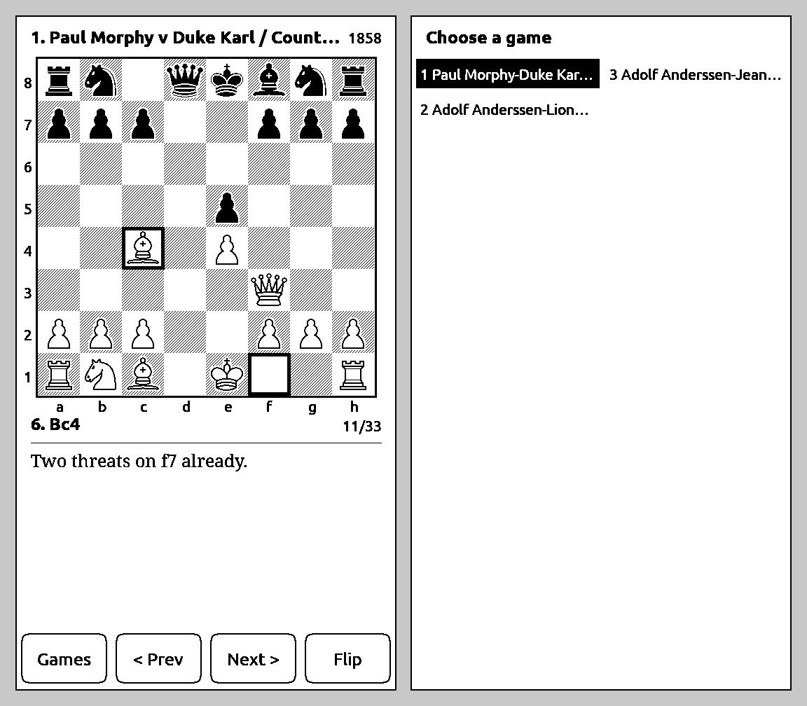

# T5 Chess Guide

A native chess-book viewer for the **LilyGo T5 E-Paper S3 Pro** (ESP32-S3, 4.7" 960×540 e-ink, touch), tuned until the
e-ink panel itself is the bottleneck.



| Action (finger down → ink settled, median) | First working version | Now | Panel's own limit |
|---|---|---|---|
| Next / previous move | ~820 ms | **269 ms** | ~240 ms |
| Open the guide | ~2,250 ms | **371 ms** | ~338 ms |
| Choose a game | 778 ms | **327 ms** | ~300 ms |
| Next page of a note | 672 ms | **251 ms** | ~240 ms |

The ink starts moving **~24 ms after the finger lands**. Everything after that is the panel's fastest waveform.

It also keeps your place in step with a web version of the same book: read a few moves on the phone, pick up the
e-reader, and it opens where you left off.

## How it got fast

Ten measured rounds, each one the same loop: time every stage on the device, rank the bottlenecks, file each as an
issue, fix them in order, re-measure, audit. The full write-up is **[docs/latency.md](docs/latency.md)**; the short
version:

- **Do the work before the tap.** While you read, the likely next frames (next move, previous move, next note page,
  the games list, the likely game picks) are drawn into spare PSRAM frames *and diffed against the screen*. A tap copies
  only the changed rectangles and hands them to the display driver: no drawing, no diff.
- **Never wait on the panel in the input path.** Frames are written straight into the EPD driver's buffer and the
  call returns while the waveform runs; a watcher task reports when the ink settles, so touch keeps being polled.
- **Act on touch-down, not release.** Buttons fire when the finger lands; swipes fire mid-gesture once the direction
  is unambiguous (80 px, |dx| > 2|dy|). That removed a hidden 300 ms release grace.
- **Draw in the panel's layout.** The board is blitted from 26 pre-rendered square tiles stored in the panel's native
  bit order (portrait is rotated 90°, so a square column is a 60-bit row): 33 ms → 6 ms, pixel-identical.
- **Measure honestly.** "Done" is the driver's waveform-complete signal, not when the call returns, and input is a
  simulated finger through the real touch path, not an injected event.

## What's here

| Path | What it is |
|---|---|
| [firmware](https://github.com/hudsonwa/T5S3-Reader/tree/chess-guide) | Fork of [T5S3-Reader](https://github.com/ShallowGreen123/T5S3-Reader) (MIT), branch `chess-guide`: the guide, display and touch changes, USB test protocol |
| `tools/export_lcc.py` | PGN → `lcc.bin`, the device's data file, with every position precomputed ([format](docs/data-format.md)) |
| `tools/check_lcc.py` | Independent parser that replays every game and checks each stored board and move |
| `tools/*.py`, `tools/regression.sh` | On-device test harness over USB: latency, every action, partial-vs-full redraw, dropped presses, sync, other screens |
| `sync-service/` | ~100-line position sync server (last write wins), with tests |
| `demo/` | Three public-domain games with short notes, ready to copy to the card |
| `docs/bottlenecks/` | All 35 bottleneck issues, each with its measurement and fix |
| `docs/rounds/`, `docs/audits/` | Per-round reports and the adversarial audits with responses |

## Try it

```bash
pip install python-chess pillow
python tools/export_lcc.py demo/demo.pgn lcc.bin   # or your own PGN; comments become the notes
python tools/check_lcc.py lcc.bin demo/demo.pgn
```

Flash the firmware (`pio run -e t5s3-pro -t upload` on the `chess-guide` branch), copy `lcc.bin` to the root of the
microSD card, and pick **Chess Guide** on the home screen. For sync, run `sync-service/server.py` somewhere on your
network and put `{"url": "http://<server>:8120/state"}` in `/.crosspoint/chess_sync.json` on the card.

The book this was built for (Irving Chernev, *Logical Chess: Move by Move*) is copyrighted, so neither its notes nor
a data file built from it are in this repository. Any PGN works.

## Testing

Everything above was measured on the device, not a simulator. The firmware takes commands over USB serial
(simulated touch and drag, screenshots from the panel driver's own buffer, file transfer with per-chunk CRC), and the
harness in `tools/` drives it. See [docs/testing.md](docs/testing.md).

## Licence

MIT. Chess piece images are Colin M.L. Burnett's set as shipped by [python-chess](https://github.com/niklasf/python-chess)
(see [assets/README.md](assets/README.md)).
